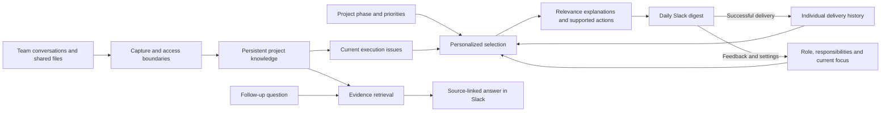
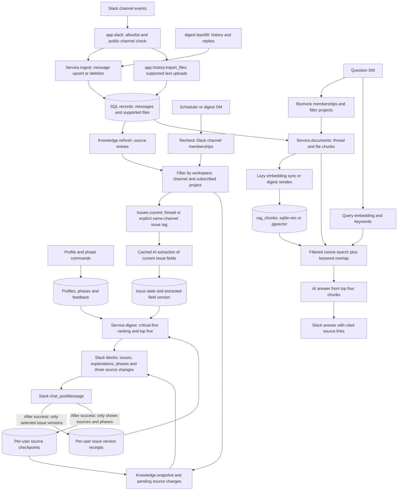

# EverCurrent Digest

A Python Slack bot that helps each person understand **what needs attention, why it matters to them, and which next actions are supported by the team's discussion**. One workspace per running app; no separate frontend required. The daily digest is the primary product. RAG and collected documentation support investigation of its evidence.

## Personalization and current execution state

- Role, responsibilities, project subscriptions and editable relevance terms determine individual relevance.
- Admin-configured project phases change ranking priorities. Users can change their focus at any time; it persists until changed or cleared.
- Source-backed issue records store current summary, status, type, owner, deadline, next action and dependency when supported by evidence.
- Open blockers and risks rank ahead of routine news and remain eligible regardless of age. Up to five issues appear per digest.
- Every item explains “Why you.” Actions, owners and deadlines are extracted from sources, never intentionally assigned by the bot. Unspecified actions are labeled explicitly.
- Per-user receipts track the exact issue versions sent. Unchanged routine items stop repeating; unseen items remain eligible. Changes to profile or phase can bring previously delivered items back. Open blockers/risks are labeled “Still open”; previously delivered issues can return as resolved.

The ranking is an explainable heuristic, not a trained relevance model. Embeddings support question retrieval, not digest ranking. Demonstrating these behaviors on realistic conversations matters more than adding more retrieval features.

## System architecture — general view



## Exact data flow — implemented paths



Offline mode substitutes deterministic extraction and keyword retrieval; it does not generate fake embeddings. Capture works independently of model availability. Extraction runs on read and is cached.

## Issue identity and delivery tracking

Each thread is an issue by default. To link separate threads explicitly, include the same tag in each:

```text
[issue:thermal-01] Motor controller failed thermal testing; validation is blocked.
[issue:thermal-01] Resolved: revised cooling passed the retest.
```

Tags merge only within the same workspace, project and channel, preserving access boundaries. A thread containing multiple different tags stays separate. Current state is rebuilt from live source evidence, including observed edits and deletions. `status` uses issue records; `docs` retains separate source entries. Untagged cross-thread contradictions are not automatically reconciled.

Issue versions hash extracted fields rather than raw messages: an acknowledgement can leave the version unchanged. Model paraphrases can still cause false changes. Only issue versions actually sent receive per-user receipts; preparing a digest or a failed Slack send does not advance them. Source-change checkpoints also advance only for displayed sources, so pending unseen changes may predate the last digest. Reading `changes` does not acknowledge them.

On upgrade, old data is preserved and issue records are built lazily. Historical source checkpoints remain; earlier omissions cannot be reconstructed. New issue receipts begin with the first updated digest. Existing focus values, including previously expired values, become active until changed or cleared with `focus clear`. Restart `digest slack`; no embedding reindex is required for these digest changes.

## Example chats — screenshot placeholders

Add screenshots to `docs/screenshots/` and uncomment the image links below. Use synthetic conversations and omit credentials.

### Onboarding and priorities

_Insert: setup form with role, responsibilities, project and focus._

<!--  -->

### Same evidence, different recipients

_Insert: mechanical, electrical and supply-chain digests. Highlight different relevance explanations and source-backed actions._

<!--  -->
<!--  -->
<!--  -->

### Changing phase or focus

_Insert: before/after digests following a phase or personal-focus change._

<!--  -->

### Resolution and follow-up question

_Insert: an issue resolves, then a question returns an answer with source links._

<!--  -->
<!--  -->

Start with [ROBOTICS_DEMO.md](ROBOTICS_DEMO.md) for a copy-and-paste robotics conversation tailored to serena mit, serena, and serenahuang225. It includes setup DMs, project phases, follow-up questions and expected behavior.

See [COMMANDS.md](COMMANDS.md) for living documentation, project status, changes since your last digest, and onboarding for any kind of team.

## Run the credential-free demo

```sh
python3 -m venv .venv
source .venv/bin/activate
pip install -e '.[dev]'
digest demo
pytest
```

The demo uses an isolated in-memory database and prints three role-specific rankings plus retrieved source excerpts. It does not contact Slack or an AI provider. Offline mode uses deterministic extraction and keyword retrieval; it is not semantic RAG.

## Connect your test Slack workspace

1. Visit https://api.slack.com/apps and choose **Create New App → From a manifest**. Select your test workspace and paste `slack-manifest.json`.
2. Install the app to the workspace. Copy the **Bot User OAuth Token** (`xoxb-…`) from OAuth & Permissions.
3. Under Basic Information → App-Level Tokens, generate an app token with `connections:write`. Copy the `xapp-…` token. Socket Mode is enabled by the manifest.
4. Copy `.env.example` to `.env`. Set `SLACK_BOT_TOKEN` and `SLACK_APP_TOKEN`. Keep `.env` private. The signing secret is needed only for HTTP mode.
5. Create public test channels, invite **EverCurrent Digest**, and copy each channel ID from its details. Set `CHANNEL_PROJECTS`, e.g. `{"C0123":"atlas","C0456":"atlas"}`. Add your Slack member ID to `PROJECT_ADMIN_IDS`.
6. Run `digest slack` and keep the terminal and computer awake for live messages. Run `digest backfill` separately to import earlier history or recover messages posted while offline.
7. Open the app's Messages tab and send `start` for the setup form, or `setup mechanical atlas` for quick setup, then `digest`. Separate users register their own roles, projects and responsibilities. Send `help` for all commands.
8. Try `focus thermal tests`, `phase atlas validation`, and `Why is the encoder shipment delayed?`.

Commands are ordinary DMs, not slash commands. Roles and phases accept free text; mechanical, electrical, supply, manager and product are optional role presets, and prototype, validation and production are optional phase presets. Use `setup mechanical atlas` for the robotics demo. Focus persists until changed or cleared. Quick setup preserves existing focus unless changed explicitly; `settings` edits all fields.

Names: grant the **users:read** bot scope and reinstall the Slack app to enable display-name lookups. The bot prefers Slack display names, falls back to real/account names, and caches them per workspace for 24 hours. Names are substituted in retrieved context, answers and digests; internal identity and permission checks continue using Slack IDs. Restart the bot after updating code/scopes. Previously posted answers are not modified.

Only public allowlisted channels are ingested. Membership is checked before every digest or answer, and access errors fail closed. Private channels and conversations between other users are intentionally unsupported. Bot DMs are commands/questions and are not added to shared project knowledge.

## Enable semantic RAG

### Import existing messages and files

Add **files:read** under Slack's **OAuth & Permissions → Bot Token Scopes**, then **Reinstall to Workspace** to grant it. Under Event Subscriptions add the **file_deleted** bot event and save. These settings are also in the updated `slack-manifest.json`; applying the manifest requires reinstalling after scope changes. Invite the bot to your configured public channels.

```sh
digest backfill --limit 500
```

This reads up to 500 history entries per configured channel, plus replies for discovered threads, and reports counts and warnings. Re-running updates existing records without duplicating messages. Import is local and does not post to Slack or call Gemini. Limits also bound thread pagination; increase `--limit` when the report says a limit was reached. Slack retention and token permissions still apply. Permission failures and rate limits are reported as partial imports: fix the issue and rerun. Threads whose parents lie outside the history window are not discovered.

Text attachments shared in those messages are downloaded using the bot token, split into overlapping chunks, and included in question retrieval with file source links. Supported: UTF-8 TXT, Markdown, CSV/TSV as text, JSON, LOG, YAML and Python text files. Limits: 1 MiB and 60,000 characters per file. PDFs, Word, Excel workbooks, images, CAD, external Drive links, and scanned documents are not yet parsed. File snippets enrich answers; the digest ranks the channel discussions rather than treating every document chunk as a new update.

Restart `digest slack` after updating the code to capture future attachments. Both RAG and issue selection can use all imported dates. Upload `fixtures/atlas-spec.md` for a small test, backfill, then ask: `What is Atlas's controller temperature limit?`

File edits are refreshed on another backfill or a message update, not on every question. Live deletion events remove files from active retrieval. Backfill is not a full deletion reconciliation: deletions missed while offline, and extracted caches, may remain stored. Use synthetic data for this prototype. Access filtering occurs through the source channel and current membership checks in the Slack handler.

Create a Gemini API key in https://aistudio.google.com/ and set:

```dotenv
AI_PROVIDER=gemini
GEMINI_API_KEY=your-key
GEMINI_MODEL=gemini-2.5-flash
EMBEDDING_MODEL=gemini-embedding-001
```

Choose models available to your account's free tier; availability and quotas can change. Free-tier content may be used to improve Google's products, so use synthetic interview data. No paid fallback is enabled. Provider failures surface as errors, rather than silently substituting fabricated output.

The app groups messages by Slack thread and splits long threads/files into bounded chunks. Gemini produces 768-dimensional embeddings, normalized and persisted in `rag_chunks`. Retrieval combines keyword overlap with database cosine similarity, filtering by workspace, accessible channel and subscribed project before selecting results. The app also checks that each indexed source still exists. Gemini generates an answer from the top four chunks and is asked to cite numbered sources; Slack renders compact links for cited sources. Generated claims still require evaluation: citations are not a proof of factual correctness.

### Persistent vector search

Run `digest reindex` to prepare embeddings for imported messages and files. Existing compatible cached vectors are reused; unchanged chunks skip Gemini calls. Changed content or a new embedding-model setting causes re-embedding. Changing only the answer model does not invalidate the new vector table. On a question, new or edited accessible chunks are also indexed lazily. Retrieval no longer calls the summary model for each document: summaries are extracted for digests, documentation, status and change reports and cached until source content changes.

The backend follows `DATABASE_URL` automatically:

- **SQLite (current local demo):** `sqlite-vec` runs native cosine-distance search in SQL over persistent vectors. This is exact search over filtered rows, not an approximate-nearest-neighbor index. There is no hosting account or additional service required.
- **Postgres/Supabase:** `pgvector` stores `vector(768)` values and an HNSW cosine index. The database user must be able to enable the `vector` extension and create the table/index. If Supabase already installed the extension in `extensions`, ensure that schema is on the connection's search path. This backend is implemented but was not exercised against a live Postgres server during local development.

Both backends keep metadata filters in the vector SQL query. Keyword matching and final hybrid ranking still happen in Python over current accessible chunks. HNSW is approximate and restrictive filters may return fewer results; for a larger deployment tune iterative scans/recall and move keyword search into SQL. The current source list and indexing work still scale with corpus size, so this is a small-team prototype rather than a production retrieval service.

To inspect retrieval without sending a Slack message or generating an answer:

```sh
digest search --user YOUR_SLACK_USER_ID --question "Why did the robot overheat?"
```

This checks current Slack channel memberships, generates one query embedding, and prints matched source URLs, cosine similarity and keyword overlap. Scores are retrieval signals, not calibrated confidence probabilities. Offline mode continues to use keyword search and does not manufacture embeddings.

New code: `app/vectors.py` owns the persistent table, synchronization, validation, and native vector query. Tests in `tests/test_vectors.py` verify persistence, permissions, edits/deletions, model invalidation, and retrieval without summary-model calls. Stale vectors within an indexed scope are removed on synchronization. Current-source filtering prevents stale rows outside that scope from being returned, but this is not a full retention/purge mechanism.

## Database and scheduling

SQLite (`digest.db`) persists local state by default. To use Supabase, set `DATABASE_URL` to a SQLAlchemy psycopg connection URL from your project's connection settings, such as `postgresql+psycopg://...`, using SSL and a connection mode supported by your network. No Supabase service-role key is needed. `digest init` creates tables. Changing databases does not copy existing data.

The prototype uses a typed-record table containing messages, users, phases, extraction caches, feedback and delivery records, plus the dedicated `rag_chunks` vector table. Existing record data is preserved when the new table is created. Changing `DATABASE_URL` does not copy your SQLite records into Postgres; migrate those records before reindexing in a new database. Normalized domain tables and versioned Alembic migrations are follow-up work. `create_all` creates new tables but does not migrate schema changes.

`digest slack` schedules delivery at `DIGEST_HOUR` in `DIGEST_TIMEZONE`. The process must stay running. Alternatively, run `digest send-daily` from your scheduler. This sends messages to registered users in the installed workspace. A persisted per-user/day record suppresses repeated scheduled deliveries. A crash after Slack accepts a message but before its delivery record is saved can still cause a duplicate; run only one scheduler instance. Manual `digest` requests intentionally bypass daily suppression.

Optional HTTP serving: set the signing secret and run `uvicorn app.main:api --host 0.0.0.0 --port 8000`. Disable Socket Mode and configure Slack's Events and Interactivity Request URLs as your public HTTPS `/slack/events`. Bolt verifies incoming requests. HTTP mode does not start a scheduler; run `digest send-daily` separately. Use a persistent server process for event work; serverless deployment requires a durable job queue before acknowledging events.

## Try these fake messages

Post each as a separate thread in an allowlisted channel:

- `Enclosure CAD tolerance decision: approved aluminum material for the Atlas prototype.`
- `Motor controller rev B failed thermal test at 92°C. Validation is blocked. Alex owns the retest due Tuesday.`
- `Supplier risk: encoder lead time increased from 3 to 8 weeks. Jordan is checking alternate vendors.`
- `PCB voltage test passed. Power rail is stable at 12V.`
- `Milestone deadline Friday: integration is blocked until enclosure signoff.`
- `Customer requirement: the launch unit needs quieter actuator operation.`

Reply to the thermal thread: `Resolved: the new heat sink passed the retest.` Generate another digest to see its status change. Change phase to production and compare the supply-risk ranking. Feedback changes that specific issue's score; it does not yet learn general topic preferences.

## Scope and next improvements

Implemented: live ingestion, bounded history/reply backfill, supported text attachment retrieval, automatic source documentation, current project status, successful-digest change checkpoints, custom role/responsibility onboarding, custom phases, message upserts/edits/deletion from active retrieval, thread chunks, personalized ranking, per-issue feedback, source links, daily DMs, keyword demo, Gemini extraction/semantic RAG, optional HTTP adapter.

Limitations: role/phase relevance still uses word matching, with additive phase boosts rather than a learned role-by-phase model. “Why you” explains these actual rules, not inferred business impact. No automatic phase detection or generalized feedback learning. Each thread or explicitly linked group has one issue; multiple independent tasks are not split out. Files support documentation/RAG but do not independently create tracked issues. Long context is bounded to 16,000 characters. Model-derived state and actions need source verification. Top-five selection can omit critical issues when many are active; use `status` for a broader overview. Persistent blockers intentionally repeat, and source changes can overlap digest items. Extraction and embedding are lazy, so first use can be slow. Old caches/checkpoints are not automatically purged. There is no durable processing queue, retention system, migration framework or production delivery guarantee.

## Code map and evaluation

- `app/core.py`: storage, profiles, phases, extraction, digest ranking and RAG orchestration.
- `app/issues.py`: stable issue identities, evidence-backed state and per-user version receipts.
- `app/knowledge.py`: source documentation, snapshots, pending changes and issue-based status.
- `app/slack.py`: event handling, permissions, commands, digest delivery and scheduling.
- `app/history.py`, `app/vectors.py`: backfill/file import and persistent embedding search.
- `app/commands.py`, `app/reports.py`, `app/formatter.py`, `app/names.py`: onboarding, report formatting, source links and display names.
- `app/cli.py`, `app/main.py`: CLI entry points and optional HTTP adapter.

Demo acceptance checks: use the same evidence for three roles; show relevant differences with explanations; change phase and focus; confirm routine updates stop repeating; retain old unresolved blockers; resolve a tagged issue in another thread; verify unseen items beyond the top five remain eligible. Check every action against its source. Compare with a generic summary to assess actual usefulness—passing unit tests alone does not establish digest quality.

Tests cover role differences, workspace/channel isolation, updates and deletion, resolution, phase/feedback changes and thread chunking. Real Slack and Gemini integration needs your credentials and has not been exercised by the offline test suite.

Official references: [Slack Socket Mode](https://docs.slack.dev/tools/bolt-python/concepts/socket-mode/), [Gemini embeddings](https://ai.google.dev/gemini-api/docs/embeddings), [Supabase semantic search](https://supabase.com/docs/guides/ai/semantic-search).
